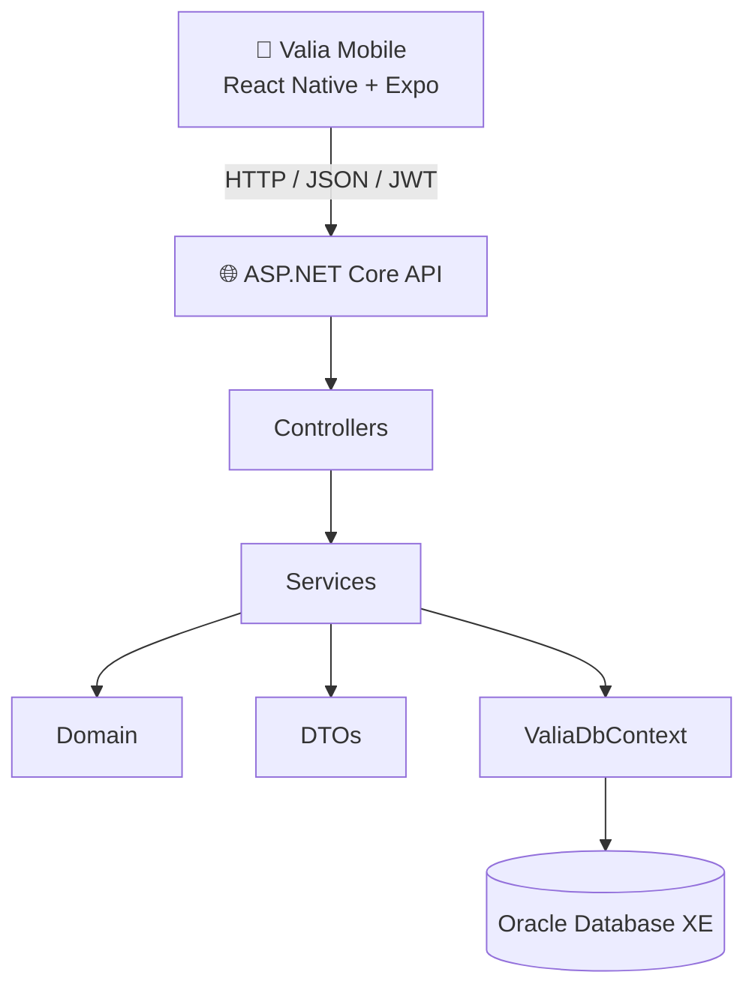
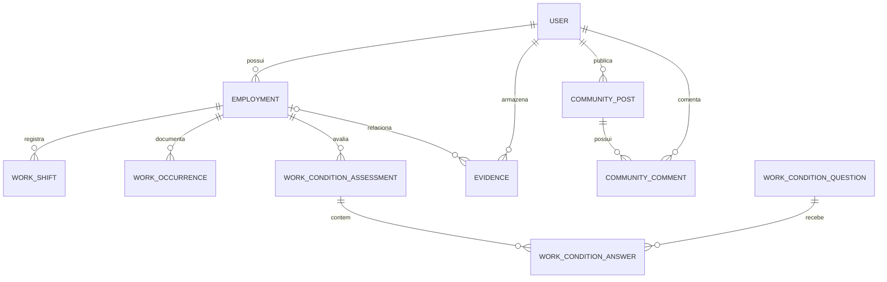
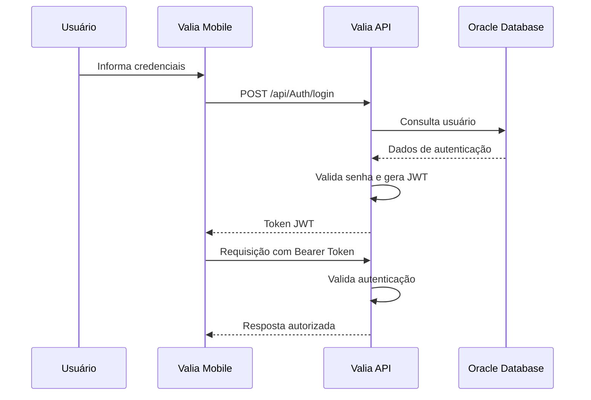

 <div align="center">

# ⚖️ VALIA

### Tecnologia a serviço da dignidade e dos direitos de quem trabalha.

**API RESTful | CitizenTech | Direitos Trabalhistas**


**Conscientização • Prevenção • Autonomia • Dignidade**

</div>

---

## 🌷 Sobre o projeto

O **Valia** é uma plataforma *CitizenTech* desenvolvida para democratizar o acesso à informação sobre direitos trabalhistas, oferecendo ferramentas digitais para que trabalhadores acompanhem sua rotina profissional, organizem registros e compreendam melhor suas condições de trabalho.

A solução foi concebida a partir de uma premissa central:

> **Informação é um instrumento de autonomia. Conhecer os próprios direitos é um passo fundamental para exercê-los.**

A plataforma reúne funcionalidades de caráter **preventivo, informativo e organizacional**, permitindo registrar vínculos profissionais, acompanhar jornadas, documentar ocorrências, armazenar evidências, avaliar condições de trabalho e compartilhar experiências em comunidade.

> [!IMPORTANT]
> O Valia possui caráter educativo e informativo. Seus indicadores não constituem pareceres jurídicos e não substituem orientação profissional especializada.

---

## 📑 Índice

- [Sobre o projeto](#-sobre-o-projeto)
- [Objetivos](#-objetivos)
- [Tecnologias](#-tecnologias)
- [Arquitetura](#-arquitetura)
- [Estrutura do projeto](#-estrutura-do-projeto)
- [Funcionalidades](#-funcionalidades)
- [Modelo de dados](#-modelo-de-dados)
- [Endpoints](#-endpoints)
- [Autenticação e segurança](#-autenticação-e-segurança)
- [Instalação e execução](#-instalação-e-execução)
- [Exemplos de requisições](#-exemplos-de-requisições)
- [Documentação Scalar](#-documentação-scalar)
- [Regras de negócio](#-regras-de-negócio)
- [Testes](#-testes)
- [Identidade visual](#-identidade-visual)
- [Melhorias futuras](#-melhorias-futuras)
- [Contexto acadêmico](#-contexto-acadêmico)

---

## 🎯 Objetivos

O Valia busca aproximar a tecnologia das necessidades reais dos trabalhadores, contribuindo para a construção de uma experiência digital mais acessível e humanizada.

| Objetivo | Descrição |
|---|---|
| 📚 **Conscientização** | Ampliar o acesso à informação sobre direitos trabalhistas |
| 🛡️ **Prevenção** | Incentivar o acompanhamento das condições de trabalho |
| 🗂️ **Organização** | Centralizar registros, documentos e ocorrências |
| 📊 **Acompanhamento** | Disponibilizar indicadores sobre jornadas e descanso |
| 🤝 **Comunidade** | Estimular a troca de experiências e conhecimentos |
| 🔐 **Privacidade** | Proteger informações pessoais e profissionais |

---

## 🛠️ Tecnologias

<div align="center">

| Backend | Persistência | Segurança | Documentação |
|:---:|:---:|:---:|:---:|
| ASP.NET Core 10 | Oracle Database XE | JWT Bearer | OpenAPI |
| C# | Entity Framework Core | PasswordHasher | Scalar |
| RESTful API | Oracle EF Provider | Authorization | Problem Details |

</div>

### Stack principal

- **ASP.NET Core 10:** desenvolvimento dos endpoints RESTful.
- **C#:** implementação das regras de negócio.
- **Entity Framework Core:** persistência e mapeamento objeto-relacional.
- **Oracle Database XE:** banco de dados relacional.
- **JWT Bearer:** autenticação e proteção dos endpoints.
- **Scalar:** documentação interativa e execução de requisições.
- **Git e GitHub:** versionamento do código.
- **React Native + Expo:** aplicativo mobile consumidor da API.

---

## 🏗️ Arquitetura

O backend utiliza uma arquitetura organizada por responsabilidades, separando o processamento das requisições HTTP, as regras de negócio e o acesso aos dados.



### Responsabilidades

| Camada | Responsabilidade |
|---|---|
| **Controllers** | Recebimento das requisições e respostas HTTP |
| **Services** | Regras de negócio e validações |
| **Domain** | Entidades, enums e comportamentos |
| **DTOs** | Contratos de entrada e saída |
| **Data** | DbContext, mapeamentos e migrations |
| **Security** | Autenticação, JWT e senhas |
| **Middleware** | Tratamento global de exceções |

As entidades utilizam encapsulamento com `private set`, construtores e métodos específicos para preservar a consistência do domínio.

A persistência é realizada diretamente pelos Services por meio do `ValiaDbContext`, utilizando injeção de dependência.

---

## 📁 Estrutura do projeto

```text
📦 ValiaApiWeb
│
├── 📂 Controllers
│   ├── AuthController.cs
│   ├── UserController.cs
│   ├── EmploymentController.cs
│   ├── WorkShiftController.cs
│   ├── WorkShiftAnalysisController.cs
│   ├── WorkOccurrenceController.cs
│   ├── EvidenceController.cs
│   ├── WorkConditionQuestionController.cs
│   ├── WorkConditionAssessmentController.cs
│   ├── CommunityPostController.cs
│   └── CommunityCommentController.cs
│
├── 📂 Domain
│   ├── 📂 Models
│   ├── 📂 Enums
│   └── 📂 Exceptions
│
├── 📂 DTOs
│   ├── 📂 Requests
│   └── 📂 Responses
│
├── 📂 Services
│   ├── 📂 Interfaces
│   └── Implementações dos Services
│
├── 📂 Data
│   ├── ValiaDbContext.cs
│   ├── 📂 Migrations
│   └── WorkConditionQuestionSeeder.cs
│
├── 📂 Security
├── 📂 Middleware
│
├── Program.cs
├── appsettings.json
├── appsettings.Development.json
└── ValiaApiWeb.csproj
```

---

## ✨ Funcionalidades

O Valia possui módulos independentes, mas integrados por meio dos vínculos profissionais e da identidade do usuário autenticado.

### 🔐 01. Autenticação e usuários

Permite o gerenciamento seguro das contas da plataforma.

**Recursos:**

- Cadastro de usuários.
- Login com e-mail e senha.
- Geração de tokens JWT.
- Consulta dos dados do usuário autenticado.
- Atualização de e-mail.
- Atualização de telefone.
- Desativação da conta.

As senhas são armazenadas por hash, utilizando o `PasswordHasher` do ASP.NET Core Identity.

### 💼 02. Vínculos profissionais

Permite cadastrar e acompanhar informações relacionadas às relações de trabalho.

**Dados registrados:**

- Cargo ou função.
- Modalidade de contratação.
- Data de admissão.
- Data de desligamento.
- Salário-base.
- Carga horária semanal.
- Categoria profissional.

**Modalidades contempladas:**

`CLT` · `Estagio` · `Aprendizagem` · `Autonomo` · `Temporario` · `Outro`

### ⏰ 03. Jornadas de trabalho

Permite registrar jornadas associadas aos vínculos profissionais.

**Funcionalidades:**

- Registro de início e término.
- Registro de intervalo.
- Cálculo de horas efetivamente trabalhadas.
- Suporte a jornadas que atravessam a meia-noite.
- Validação de horários.
- Prevenção de sobreposição de jornadas.
- Consulta, atualização e exclusão.

### 📊 04. Análise de jornadas

Transforma os registros de jornadas em indicadores informativos.

| Indicador | Descrição |
|---|---|
| Total de jornadas | Quantidade de registros no período |
| Horas trabalhadas | Soma das durações efetivas |
| Média de horas | Média por jornada |
| Jornadas acima de 8h | Quantidade de jornadas acima do limite de referência |
| Descanso inferior a 11h | Identificação de intervalos reduzidos entre jornadas |

> [!NOTE]
> Os indicadores são educativos. A identificação de uma possível irregularidade não equivale à comprovação de infração trabalhista.

### 📝 05. Ocorrências trabalhistas

Permite documentar acontecimentos relacionados ao ambiente profissional.

**Categorias disponíveis:**

- Alteração de escala.
- Atraso de pagamento.
- Alteração de função.
- Conflito profissional.
- Condições inseguras.
- Discriminação.
- Assédio.
- Outros acontecimentos.

Cada ocorrência possui categoria, descrição, data e vínculo associado.

### 🗃️ 06. Cofre de evidências

Oferece armazenamento privado para documentos relacionados à vida profissional.

**Exemplos de documentos:**

- Contratos.
- Holerites.
- Comprovantes de pagamento.
- Registros de ponto.
- Escalas.
- Documentos diversos.

**Características técnicas:**

| Recurso | Implementação |
|---|---|
| Upload | `multipart/form-data` |
| Formatos | PDF, JPG e PNG |
| Tamanho máximo | 10 MB |
| Armazenamento | Diretório privado |
| Metadados | Oracle Database |
| Acesso | Usuário proprietário |
| Operações | Upload, consulta, download e exclusão |

> [!IMPORTANT]
> O Cofre de Evidências não realiza análise automática dos arquivos. Sua finalidade é armazenar e organizar documentos.

### 🌡️ 07. Avaliação das condições de trabalho

Permite que trabalhadores respondam a um questionário estruturado sobre suas condições profissionais.

**Categorias:**

| Categoria | Tema |
|---|---|
| Jornada e descanso | Organização dos horários |
| Remuneração | Condições relacionadas ao pagamento |
| Respeito profissional | Relações no ambiente de trabalho |
| Segurança | Percepção de segurança |
| Previsibilidade | Organização e comunicação |
| Condições gerais | Avaliação global |

O questionário inicial foi planejado com **12 perguntas**, distribuídas entre as seis categorias.

As respostas utilizam pontuações de **1 a 5**, com possibilidade de observações complementares.

A API permite registrar avaliações, calcular indicadores e consultar o histórico por vínculo.

### 💬 08. Comunidade Valia

Espaço para compartilhamento de experiências e dúvidas.

**Publicações:**

- Criar.
- Consultar.
- Listar.
- Atualizar.
- Excluir logicamente.
- Publicar anonimamente.

**Comentários:**

- Criar.
- Consultar.
- Atualizar.
- Excluir logicamente.
- Comentar anonimamente.

O anonimato impede a exposição da identidade do autor nas respostas públicas correspondentes.

---

## 🗄️ Modelo de dados

O projeto utiliza um banco relacional com dez entidades principais.



### Entidades

| Entidade | Finalidade |
|---|---|
| `User` | Usuários |
| `Employment` | Vínculos profissionais |
| `WorkShift` | Jornadas |
| `WorkOccurrence` | Ocorrências |
| `Evidence` | Evidências |
| `WorkConditionQuestion` | Perguntas |
| `WorkConditionAssessment` | Avaliações |
| `WorkConditionAnswer` | Respostas |
| `CommunityPost` | Publicações |
| `CommunityComment` | Comentários |

### Persistência

O Entity Framework Core utiliza:

- Fluent API.
- Migrations.
- Relacionamentos e chaves estrangeiras.
- Conversões de enums para strings.
- Conversores para propriedades `DateOnly`.
- Compatibilidade SQL com Oracle Database 21c.

---

## 🌐 Endpoints

A API utiliza o prefixo `/api`.

Os endpoints protegidos exigem autenticação Bearer.

### 🔑 Autenticação

| Método | Endpoint | Descrição |
|---|---|---|
| `POST` | `/api/Auth/register` | Cadastrar usuário |
| `POST` | `/api/Auth/login` | Realizar login |
| `GET` | `/api/Auth/me` | Consultar usuário autenticado |

### 👤 Usuários

| Método | Endpoint | Descrição |
|---|---|---|
| `PATCH` | `/api/User/me/email` | Atualizar e-mail |
| `PATCH` | `/api/User/me/phone` | Atualizar telefone |
| `PATCH` | `/api/User/me/deactivate` | Desativar conta |

### 💼 Vínculos profissionais

| Método | Endpoint | Descrição |
|---|---|---|
| `POST` | `/api/Employment` | Criar vínculo |
| `GET` | `/api/Employment/{id}` | Consultar vínculo |
| `GET` | `/api/Employment/user` | Listar vínculos do usuário |
| `PUT` | `/api/Employment/{id}` | Atualizar vínculo |
| `DELETE` | `/api/Employment/{id}` | Excluir vínculo |

### ⏰ Jornadas

| Método | Endpoint | Descrição |
|---|---|---|
| `POST` | `/api/WorkShift` | Registrar jornada |
| `GET` | `/api/WorkShift/{id}` | Consultar jornada |
| `GET` | `/api/WorkShift/employment/{employmentId}` | Listar jornadas |
| `PUT` | `/api/WorkShift/{id}` | Atualizar jornada |
| `DELETE` | `/api/WorkShift/{id}` | Excluir jornada |

### 📊 Análise de jornadas

| Método | Endpoint | Descrição |
|---|---|---|
| `GET` | `/api/WorkShiftAnalysis/employment/{employmentId}` | Consultar análise |

**Parâmetros:** `startDate` e `endDate`.

### 📝 Ocorrências

| Método | Endpoint | Descrição |
|---|---|---|
| `POST` | `/api/WorkOccurrence` | Criar ocorrência |
| `GET` | `/api/WorkOccurrence/{id}` | Consultar ocorrência |
| `GET` | `/api/WorkOccurrence/employment/{employmentId}` | Listar ocorrências |
| `PUT` | `/api/WorkOccurrence/{id}` | Atualizar ocorrência |
| `DELETE` | `/api/WorkOccurrence/{id}` | Excluir ocorrência |

### 🗃️ Evidências

| Método | Recurso | Descrição |
|---|---|---|
| `POST` | `/api/Evidence` | Upload |
| `GET` | Consulta por ID | Consultar metadados |
| `GET` | Listagem | Listar evidências |
| `GET` | Download | Baixar arquivo |
| `DELETE` | Exclusão por ID | Excluir evidência |

### 🌡️ Condições de trabalho

| Método | Endpoint | Descrição |
|---|---|---|
| `GET` | `/api/WorkConditionQuestion` | Consultar perguntas |
| `POST` | `/api/WorkConditionAssessment` | Registrar avaliação |
| `GET` | `/api/WorkConditionAssessment/{id}` | Consultar avaliação |
| `GET` | `/api/WorkConditionAssessment/employment/{employmentId}` | Listar avaliações |

### 💬 Comunidade

| Método | Endpoint | Descrição |
|---|---|---|
| `POST` | `/api/CommunityPost` | Criar publicação |
| `GET` | `/api/CommunityPost` | Listar publicações |
| `GET` | `/api/CommunityPost/{id}` | Consultar publicação |
| `PUT` | `/api/CommunityPost/{id}` | Atualizar publicação |
| `DELETE` | `/api/CommunityPost/{id}` | Excluir publicação |
| `POST` | `/api/CommunityComment` | Criar comentário |
| `GET` | `/api/CommunityComment/post/{postId}` | Listar comentários |
| `PUT` | `/api/CommunityComment/{id}` | Atualizar comentário |
| `DELETE` | `/api/CommunityComment/{id}` | Excluir comentário |

> [!NOTE]
> A documentação OpenAPI gerada pela aplicação é a referência definitiva para os caminhos e contratos dos endpoints. As rotas de evidências devem ser consultadas diretamente no Scalar.

---

## 🔒 Autenticação e segurança

A API utiliza autenticação JWT Bearer.



### Cabeçalho de autenticação

```http
Authorization: Bearer SEU_TOKEN_JWT
```

### Proteções utilizadas

- Hash de senhas.
- Validação de JWT.
- Autorização de endpoints.
- Verificação de propriedade dos recursos.
- Validação de entrada.
- Tratamento global de exceções.
- Armazenamento privado de evidências.
- Controle de formatos e tamanhos de arquivos.
- DTOs para limitar a exposição de dados.

> [!WARNING]
> A desativação de uma conta não invalida automaticamente um JWT emitido anteriormente. O bloqueio imediato exige verificações adicionais do estado do usuário.

---

## 🚀 Instalação e execução

### Pré-requisitos

- .NET SDK 10.
- Oracle Database XE.
- Visual Studio ou IDE compatível.
- Git.
- Ferramenta `dotnet-ef`.

### 1. Clonar o projeto

```bash
git clone URL_DO_REPOSITORIO
cd ValiaApiWeb
```

### 2. Restaurar dependências

```bash
dotnet restore
```

### 3. Configurar o banco de dados

A API utiliza a configuração:

`ConnectionStrings:OracleConnection`

Exemplo de connection string:

```text
User Id=USUARIO_VALIA;Password=SENHA;Data Source=localhost:1521/XEPDB1;
```

Recomenda-se utilizar User Secrets para armazenar credenciais durante o desenvolvimento.

```bash
dotnet user-secrets init
dotnet user-secrets set "ConnectionStrings:OracleConnection" "User Id=USUARIO_VALIA;Password=SENHA;Data Source=localhost:1521/XEPDB1;"
```

### 4. Configurar JWT

Exemplo das configurações públicas:

```json
{
  "Jwt": {
    "Issuer": "ValiaApi",
    "Audience": "ValiaApp",
    "ExpirationMinutes": 60
  }
}
```

Configure a chave secreta nos User Secrets:

```bash
dotnet user-secrets set "Jwt:Key" "CHAVE_BASE64_SEGURA"
```

A chave deve conter pelo menos 32 bytes após a decodificação Base64.

### 5. Aplicar migrations

```bash
dotnet ef database update --context ValiaDbContext
```

Para consultar as migrations:

```bash
dotnet ef migrations list --context ValiaDbContext
```

### 6. Compilar

```bash
dotnet build
```

### 7. Executar

```bash
dotnet run
```

A aplicação utiliza a variável `PORT`, com valor padrão `10000`.

**Endereço local:**

```text
http://localhost:10000
```

---

## 📖 Documentação Scalar

A API disponibiliza documentação interativa para explorar e testar seus endpoints.

<div align="center">

**Scalar UI**

`http://localhost:10000/scalar`

**OpenAPI JSON**

`http://localhost:10000/openapi/v1.json`

</div>

### Recursos disponíveis

- Visualização dos endpoints.
- Consulta de parâmetros e DTOs.
- Envio de requisições HTTP.
- Configuração de autenticação Bearer.
- Inspeção dos códigos de resposta.
- Testes manuais.

> [!TIP]
> Para testar endpoints protegidos, realize login e configure o token JWT no esquema Bearer da documentação.

---

## 🧪 Exemplos de requisições

<details>
<summary><strong>🔐 Cadastro de usuário</strong></summary>

**POST** `/api/Auth/register`

```json
{
  "fullName": "Maria Silva",
  "email": "maria@example.com",
  "password": "SenhaSegura@123",
  "phoneNumber": "11999999999"
}
```

</details>

<details>
<summary><strong>🔑 Login</strong></summary>

**POST** `/api/Auth/login`

```json
{
  "email": "maria@example.com",
  "password": "SenhaSegura@123"
}
```

</details>

<details>
<summary><strong>💼 Criar vínculo profissional</strong></summary>

**POST** `/api/Employment`

```json
{
  "jobTitle": "Analista de Sistemas",
  "employmentType": "CLT",
  "admissionDate": "2026-01-10",
  "terminationDate": null,
  "baseSalary": 3500.00,
  "weeklyWorkload": 44,
  "professionalCategory": "Tecnologia da Informação"
}
```

</details>

<details>
<summary><strong>⏰ Registrar jornada</strong></summary>

**POST** `/api/WorkShift`

```json
{
  "employmentId": "GUID_DO_VINCULO",
  "startTime": "2026-11-16T08:00:00-03:00",
  "endTime": "2026-11-16T17:00:00-03:00",
  "breakStart": "2026-11-16T12:00:00-03:00",
  "breakEnd": "2026-11-16T13:00:00-03:00",
  "notes": "Jornada regular."
}
```

</details>

<details>
<summary><strong>📝 Registrar ocorrência</strong></summary>

**POST** `/api/WorkOccurrence`

```json
{
  "employmentId": "GUID_DO_VINCULO",
  "category": "AtrasoPagamento",
  "description": "O pagamento foi realizado após a data prevista.",
  "occurredAt": "2026-11-10T10:00:00-03:00"
}
```

</details>

<details>
<summary><strong>💬 Criar publicação</strong></summary>

**POST** `/api/CommunityPost`

```json
{
  "category": "Duvida",
  "title": "Dúvida sobre horas extras",
  "content": "Gostaria de entender melhor como funciona o pagamento de horas extras.",
  "isAnonymous": true
}
```

</details>

<details>
<summary><strong>💭 Criar comentário</strong></summary>

**POST** `/api/CommunityComment`

```json
{
  "communityPostId": "GUID_DA_PUBLICACAO",
  "content": "Também tenho dúvidas sobre esse assunto.",
  "isAnonymous": false
}
```

</details>

---

## ⚙️ Regras de negócio

| Módulo | Regra |
|---|---|
| 👤 Usuários | E-mail único |
| 🔐 Autenticação | Senhas armazenadas por hash |
| 💼 Vínculos | Acesso restrito ao proprietário |
| 💼 Vínculos | Bloqueio de exclusão com jornadas associadas |
| ⏰ Jornadas | Validação de horários e intervalos |
| ⏰ Jornadas | Prevenção de sobreposição |
| 📊 Análise | Indicadores calculados dinamicamente |
| 📝 Ocorrências | Operações restritas ao proprietário |
| 🗃️ Evidências | Validação de formato e tamanho |
| 🗃️ Evidências | Armazenamento privado |
| 🌡️ Avaliações | Pontuação entre 1 e 5 |
| 🌡️ Avaliações | Controle de versão do questionário |
| 💬 Comunidade | Publicações e comentários anônimos |
| 💬 Comunidade | Exclusão lógica |

---

## ⚙️ Implementações adicionais do Backend (.NET)

Além das funcionalidades principais, o backend do **Valia** recebeu melhorias voltadas à disponibilidade, segurança operacional, controle de requisições, integridade dos dados e confiabilidade da aplicação.

Essas implementações contribuem para uma API mais robusta, preparada para lidar com requisições repetidas, falhas de infraestrutura e necessidades de monitoramento.

### 🚦 01. Rate Limiting

Foi implementado um mecanismo global de limitação de requisições utilizando o middleware nativo de **Rate Limiting do ASP.NET Core**.

O objetivo é controlar a quantidade de requisições recebidas por cliente em um determinado intervalo, reduzindo o risco de sobrecarga da aplicação.

| Configuração | Implementação |
|---|---|
| **Estratégia** | Fixed Window |
| **Limite** | 100 requisições |
| **Intervalo** | 1 minuto |
| **Identificação** | Endereço IP do cliente |
| **Fila de espera** | Desabilitada |
| **Resposta ao exceder o limite** | `429 Too Many Requests` |

**Como funciona?**

1. Cada cliente é identificado pelo seu endereço IP.
2. A API contabiliza as requisições recebidas durante uma janela de um minuto.
3. Até 100 requisições são permitidas nesse intervalo.
4. Ao ultrapassar o limite, novas requisições são rejeitadas.
5. A resposta inclui o cabeçalho `Retry-After`, indicando o tempo de espera para uma nova tentativa.

**Exemplo de resposta:**

```http
HTTP/1.1 429 Too Many Requests
Retry-After: 30
```

> [!TIP]
> O Rate Limiting contribui para a estabilidade da aplicação, mas não substitui mecanismos adicionais de segurança, autenticação e proteção contra ataques distribuídos.

---

### 🔁 02. Idempotência na criação de ocorrências

Foi implementado um mecanismo de **idempotência** no endpoint responsável pela criação de ocorrências trabalhistas:

`POST /api/WorkOccurrence`

A idempotência permite que uma operação seja repetida sem gerar múltiplos registros equivalentes quando a requisição já foi processada anteriormente.

Isso é especialmente útil em situações de instabilidade de rede, nas quais o aplicativo pode reenviar uma requisição por não ter recebido a resposta original.

#### Cabeçalho utilizado

```http
Idempotency-Key: chave-unica-da-requisicao
```

#### Funcionamento

1. O cliente gera uma chave única para a operação.
2. A chave é associada ao usuário autenticado e ao endpoint.
3. O conteúdo da requisição é convertido em um hash **SHA-256**.
4. A API verifica se já existe um registro correspondente.
5. Se a mesma requisição já tiver sido processada, a resposta anterior é reutilizada.
6. Se a chave for reutilizada com conteúdo diferente, a API retorna `409 Conflict`.

| Cenário | Comportamento |
|---|---|
| Primeira requisição com chave inédita | Processa e registra a operação |
| Mesma chave e mesmo conteúdo | Retorna a resposta registrada anteriormente |
| Mesma chave e conteúdo diferente | Retorna `409 Conflict` |
| Nova chave | Trata como uma nova operação |

#### Persistência

Os registros são armazenados no Oracle Database por meio do Entity Framework Core.

A tabela `IDEMPOTENCY_RECORDS` foi adicionada ao mapeamento do `ValiaDbContext`.

O banco utiliza um índice único para a combinação:

**Usuário + Operação + Chave de idempotência**

Essa restrição contribui para impedir duplicidades no registro das chaves.

**Exemplo de requisição:**

```http
POST /api/WorkOccurrence
Authorization: Bearer SEU_TOKEN_JWT
Content-Type: application/json
Idempotency-Key: 8f92b3d1-7a40-4a91-8f12-2e0c7a5d6b30
```

> [!IMPORTANT]
> A chave de idempotência deve ser reutilizada apenas nas tentativas de repetir a mesma operação. Para registrar uma nova ocorrência, o cliente deve gerar uma nova chave.

---

### 🩺 03. Health Checks

Foram adicionados endpoints de monitoramento para verificar a disponibilidade e a prontidão da API.

| Endpoint | Tipo | Finalidade |
|---|---|---|
| `GET /health/live` | Liveness | Verifica se a aplicação está em execução |
| `GET /health/ready` | Readiness | Verifica se a aplicação está pronta para atender requisições |

#### Liveness — `/health/live`

Indica se o processo da aplicação está ativo e consegue responder às verificações básicas de disponibilidade.

#### Readiness — `/health/ready`

Verifica se a aplicação está operacional, considerando também a disponibilidade do Oracle Database.

Para isso, foi implementado o componente `OracleDatabaseHealthCheck`, que utiliza o Entity Framework Core para verificar a conectividade com o banco.

**Exemplo de comportamento:**

| Situação | Liveness | Readiness |
|---|---|---|
| API e Oracle disponíveis | Saudável | Saudável |
| API ativa, Oracle indisponível | Saudável | Não saudável |
| API indisponível | Sem resposta | Sem resposta |

> [!NOTE]
> A separação entre *liveness* e *readiness* permite distinguir falhas da própria aplicação de problemas em dependências externas, como o banco de dados.

---

### 🌱 04. Seed de perguntas iniciais

Foi integrado o `WorkConditionQuestionSeeder`, responsável pela inicialização das perguntas do questionário de condições de trabalho.

O mecanismo foi configurado para execução no ambiente **Development**, permitindo preparar os dados necessários para o funcionamento do módulo.

#### Características

- Executado somente no ambiente de desenvolvimento.
- Verifica se a conexão Oracle foi configurada.
- Não executa quando a connection string está ausente.
- Utiliza um escopo de serviços para acessar o `ValiaDbContext`.
- Possui tratamento de exceções.
- Registra eventuais falhas sem impedir a inicialização da aplicação.

**Finalidade:** disponibilizar os dados iniciais do questionário, reduzindo a necessidade de inserções manuais durante o desenvolvimento.

---

### 🌐 05. Configuração de CORS

Foi configurada a política `AllowFrontend` para permitir a comunicação entre o aplicativo frontend e a API.

Durante o desenvolvimento, a política permite:

- Requisições de diferentes origens.
- Métodos HTTP utilizados pela aplicação.
- Cabeçalhos necessários à comunicação.
- Envio do token JWT pelo cabeçalho `Authorization`.

Essa configuração facilita os testes locais e a integração com o aplicativo desenvolvido em React Native e Expo.

> [!WARNING]
> Em produção, recomenda-se restringir as origens autorizadas, evitando uma política excessivamente permissiva.

---

### 📄 06. Configurações complementares

Também foram incorporadas melhorias na configuração central da aplicação, especialmente no arquivo `Program.cs`.

| Recurso | Implementação |
|---|---|
| **Serialização JSON** | Enums representados como strings |
| **Oracle** | Compatibilidade com Database Version 21 |
| **OpenAPI** | Documentação dos endpoints |
| **Autenticação Bearer** | Configuração do esquema JWT na documentação |
| **Scalar** | Interface interativa com tema BluePlanet |
| **CORS** | Política `AllowFrontend` |
| **Rate Limiting** | Controle global de requisições |
| **Middleware** | Organização do pipeline HTTP |

O pipeline de requisições contempla os componentes de roteamento, CORS, Rate Limiting, autenticação e autorização, respeitando as dependências entre eles.

---

### 🧪 07. Validação das implementações

As melhorias foram incorporadas à aplicação e verificadas por meio de compilação e execução local durante o desenvolvimento.

#### Endpoints de verificação

```http
GET /api/status
GET /health/live
GET /health/ready
```

**Status da API — `/api/status`**

Retorna informações básicas sobre a aplicação, incluindo:

- Estado do serviço.
- Nome da API.
- Timestamp UTC da consulta.

**Liveness — `/health/live`**

Verifica a disponibilidade básica da aplicação.

**Readiness — `/health/ready`**

Verifica a prontidão da API e a disponibilidade da conexão com o Oracle Database.

#### Resumo das melhorias

| Implementação | Benefício |
|---|---|
| 🚦 Rate Limiting | Controle de tráfego e redução de sobrecarga |
| 🔁 Idempotência | Prevenção de ocorrências duplicadas |
| 🩺 Health Checks | Monitoramento de disponibilidade |
| 🌱 Seed inicial | Preparação automática dos dados de desenvolvimento |
| 🌐 CORS | Integração com o frontend |
| 🔌 Porta dinâmica | Flexibilidade de execução |
| 📄 OpenAPI e Scalar | Documentação e testes interativos |

---

## 🎓 Contexto acadêmico

O Valia é um projeto acadêmico desenvolvido no curso de **Análise e Desenvolvimento de Sistemas**, integrando conhecimentos de desenvolvimento backend, bancos de dados, autenticação, arquitetura de software, APIs RESTful e integração mobile.

O projeto busca demonstrar como a tecnologia pode contribuir para a construção de soluções digitais com impacto social.

---

## 📜 Licença

Projeto desenvolvido para fins acadêmicos.

As condições de uso, distribuição e contribuição deverão ser definidas pelos responsáveis antes de sua disponibilização pública.

---

<div align="center">

### ⚖️ VALIA

**Conscientização. Prevenção. Autonomia. Dignidade.**

*Tecnologia humanizada a serviço de quem trabalha.*

</div> 
